<div align="center">

# 00OO — Hokkaido Winter Honeymoon 2027

[](https://github.com/Timmatt-Lee/00OOhoneymoon2027/actions/workflows/deploy.yml)
[](https://timmatt-lee.github.io/00OOhoneymoon2027/)


A bespoke, mobile-first interactive itinerary and multi-layer parallax visual experience crafted for a 12-day winter journey across Hokkaido (`2027.03.02 – 03.13`).

[**Explore Live Experience ↗**](https://timmatt-lee.github.io/00OOhoneymoon2027/)

</div>

---

## Visual Storyboard

| Day 01 · New Chitose & Sapporo | Day 02 · Sapporo Urban Stroll | Day 03 · Sapporo to Asahikawa | Day 04 · Asahikawa Snowfall |
| :---: | :---: | :---: | :---: |
| 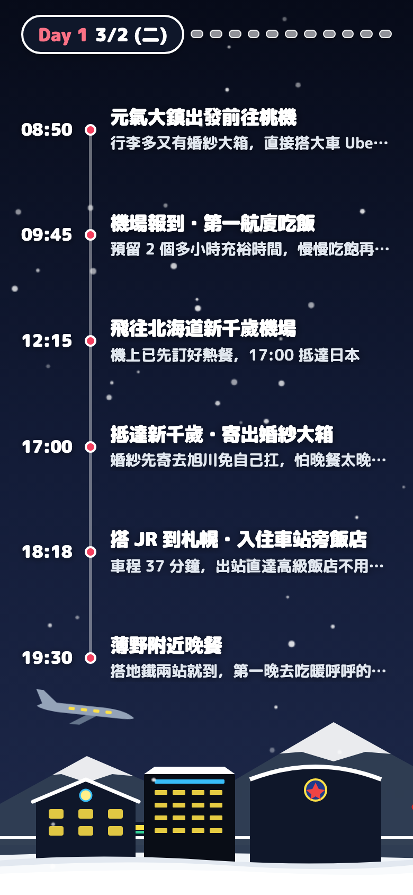 | 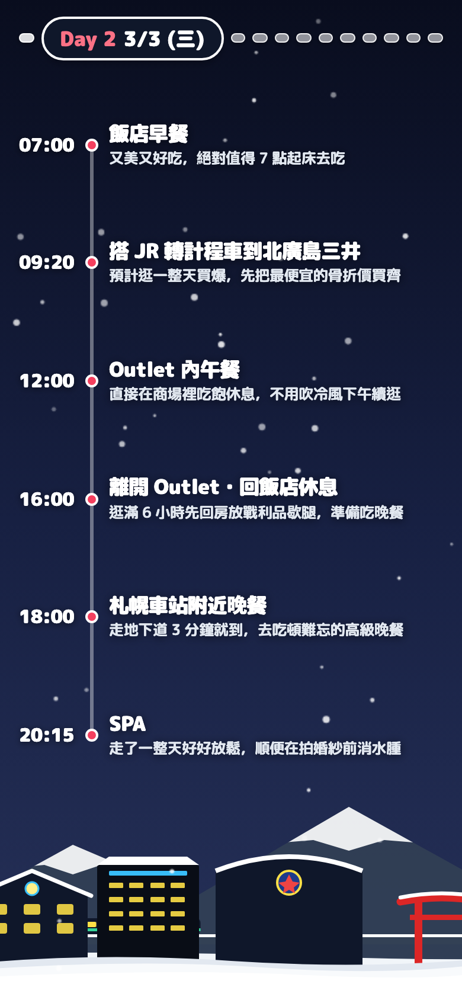 | 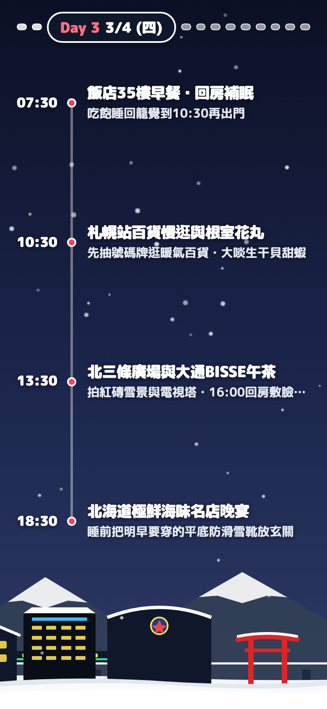 |  |
| **Day 05 · Biei Snowfields** | **Day 06 · Lake Shikotsu Onsen** | **Day 07 · Noboribetsu Valley** | **Day 08 · Lake Toya & Mt. Yotei** |
| 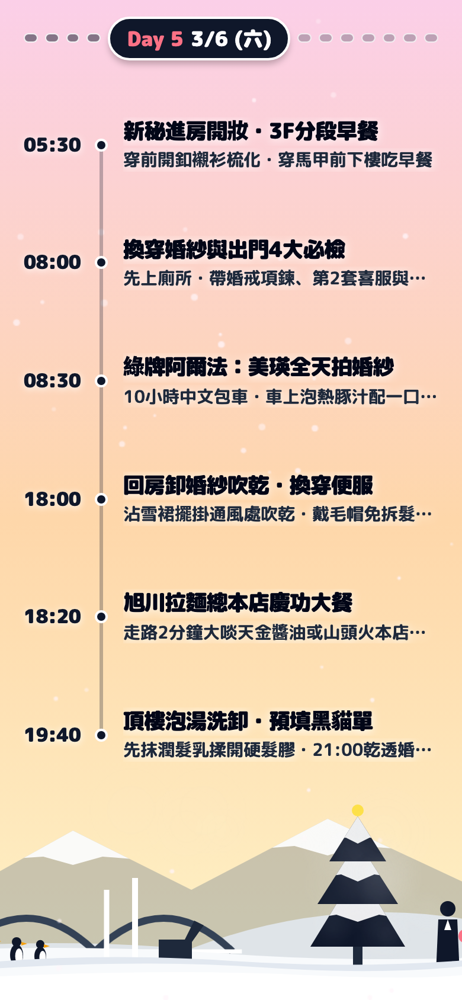 | 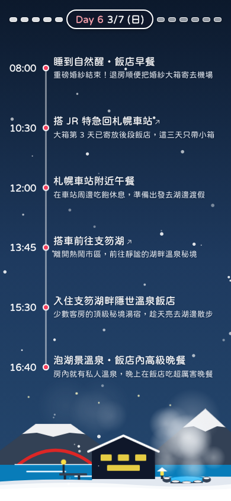 | 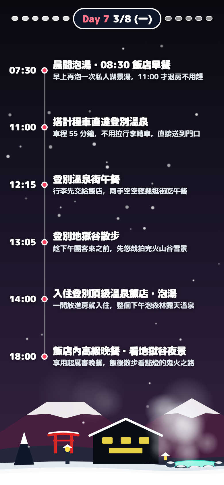 | 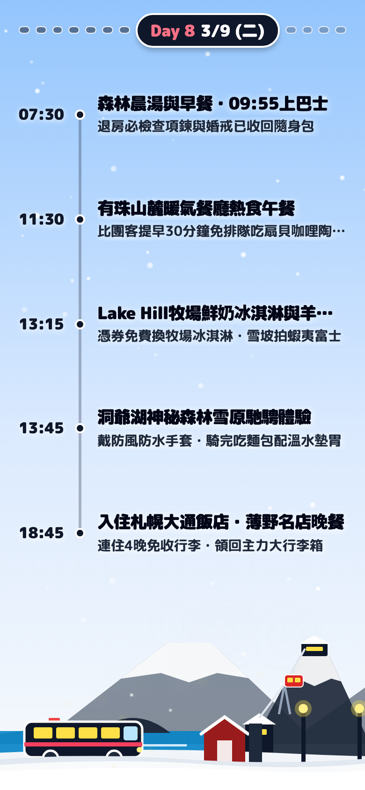 |
| **Day 09 · Otaru Coastal Rail** | **Day 10 · Historic Akarenga** | **Day 11 · Susukino & Clock Tower** | **Day 12 · Skyward Departure** |
| 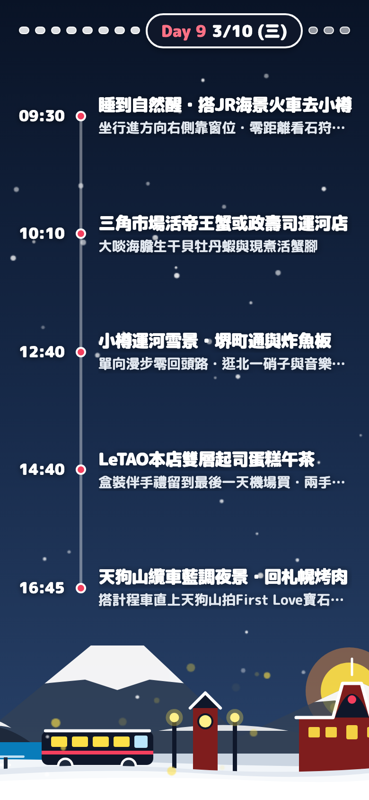 | 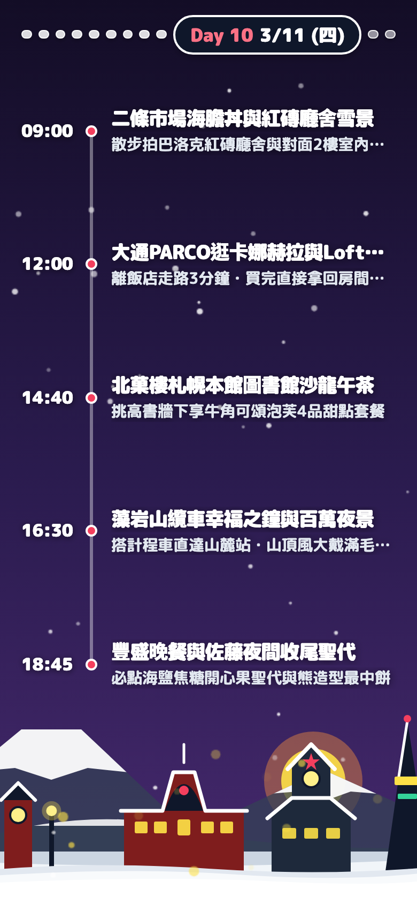 | 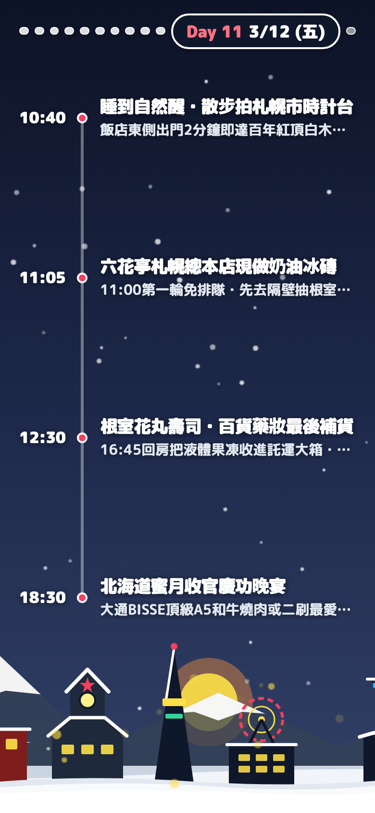 | 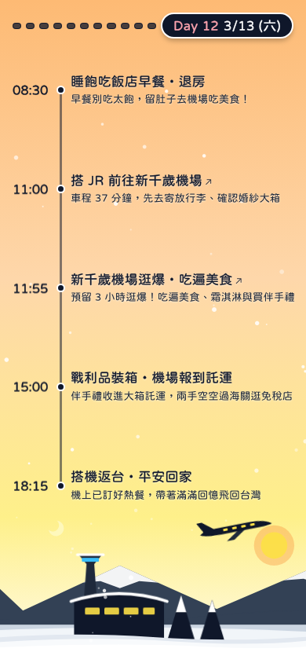 |

---

## Engineering Highlights

* **Continuous Gesture & Parallax Engine** — Sub-pixel pointer interpolation driving 3-layer SVG vector landscapes (`0.38x` / `0.68x` / `1.0x`), cross-fading atmospheric sky gradients, and synchronized timeline rail transitions at 60 FPS.
* **Zero-Allocation Canvas Particle Physics** — Pre-allocated particle pools powered by a seeded `Mulberry32` PRNG, rendering real-time snowfall, lakeside *rotenburo* steam wisps, and urban night-glow bokeh with zero runtime GC overhead.
* **Deterministic Visual Regression Gate** — End-to-end Playwright suite enforcing zero bounding-box collisions, strict schema invariants, and pixel-verified 12-day viewport snapshots on every commit.

---

## Development

```bash
npm ci
npm run dev        # Start local Vite dev server
npm run test:e2e   # Run Playwright visual & interaction suite
```
